# NeuroNest — System Architecture

## 1. Overview & Architectural Philosophy
**NeuroNest** ("*A space where every mind finds its way*") is an AI-powered, accessible digital platform tailored for individuals with diverse neurodevelopmental and cognitive profiles, including:
- **Autism Spectrum Disorder (ASD)**
- **Attention-Deficit/Hyperactivity Disorder (ADHD)**
- **Dyslexia & Reading Fatigue**
- **Dyscalculia & Number Anxiety**
- **Sensory & Executive Function Sensitivities**

The platform combines a calm, pressure-free aesthetic with interactive skill-building, structured everyday organization, and optional AI guidance.

---

## 2. High-Level Architecture Diagram

```mermaid
flowchart TD
    subgraph Client["Frontend Client (React 18 + TypeScript + Vite)"]
        UI["UI Layer (Tailwind CSS, Radix UI Primitives, Lucide Icons)"]
        ComfortStore["Accessibility Engine (Zustand: DOM Theme/Font/Motion)"]
        AuthStore["Authentication Store (JWT Token, User Session)"]
        AudioEngine["Web Audio API Sound Synth (Calm Auditory Feedback)"]
        GameHub["8 Accessible Educational Games"]
        Learning["Learning Corner (Chunked Reader, Web Speech TTS)"]
        DailyJourney["Daily Journey (Routines, Checklist, Visual Timeline)"]
        AIAssistantUI["AI Learning Guide (Consent Banner, Fallbacks)"]
        GuardianUI["Guardian Portal (Consent Controls, Child Privacy)"]
        AdminUI["Admin Dashboard (Telemetry, RBAC, Audit Logs)"]
    end

    subgraph Backend["Backend Application (Java 21 LTS + Spring Boot 3.3.5)"]
        Security["Spring Security (JWT Filter, BCrypt, Role-Based Access)"]
        AuthCtrl["Auth & User Controllers"]
        GamesCtrl["Games & Game Sessions Controller"]
        LearnCtrl["Learning Content Controller"]
        RoutineCtrl["Routines & User Tasks Controller"]
        AICtrl["AI Controller (/api/v1/ai)"]
        GuardianCtrl["Guardian & Consent Controller"]
        AdminCtrl["Admin Controller (/api/v1/admin)"]

        subgraph ServiceLayer["Service Layer"]
            AuthService["AuthService"]
            GameService["GameService (Positive Non-Punitive Scoring)"]
            LearningService["LearningService"]
            RoutineService["RoutineService (Auto-Seeding Starter Flows)"]
            AIService["AiService (Gemini API + Deterministic Fallback)"]
            GuardianService["GuardianService (Privacy-Guaranteed Summaries)"]
            AdminService["AdminService (System Telemetry & Audit Logs)"]
        end
    end

    subgraph External["External Integrations & Persistence"]
        Postgres[("PostgreSQL 16 Database (Flyway V1, V2)")]
        Gemini["Google Gemini API (REST Client with Timeout & Fallbacks)"]
    end

    UI --> AuthStore
    UI --> ComfortStore
    UI --> AudioEngine
    GameHub --> Security
    Learning --> Security
    DailyJourney --> Security
    AIAssistantUI --> Security
    GuardianUI --> Security
    AdminUI --> Security

    Security --> AuthCtrl
    Security --> GamesCtrl
    Security --> LearnCtrl
    Security --> RoutineCtrl
    Security --> AICtrl
    Security --> GuardianCtrl
    Security --> AdminCtrl

    AuthCtrl --> AuthService
    GamesCtrl --> GameService
    LearnCtrl --> LearningService
    RoutineCtrl --> RoutineService
    AICtrl --> AIService
    GuardianCtrl --> GuardianService
    AdminCtrl --> AdminService

    ServiceLayer --> Postgres
    AIService -.-> Gemini
```

---

## 3. Frontend Architecture

### 3.1 Technology Stack
- **Framework**: React 18+ with TypeScript
- **Build System**: Vite 5
- **Styling**: Tailwind CSS with custom neurodiversity design tokens
- **Component Primitives**: Radix UI (accessible dialogs, switches, tabs, sliders)
- **State Management**:
  - `useAuthStore` (Zustand with localStorage persistence)
  - `useAccessibilityStore` (Zustand with real-time DOM class mutation)
- **Audio Generation**: Web Audio API oscillator synthesis (pure client-side, zero MP3 asset latency)
- **Text-to-Speech**: Browser Native Web Speech API (`window.speechSynthesis`)
- **Data Visualization**: Recharts (non-competitive, positive milestone representations)

### 3.2 Accessibility Engine ("My Comfort")
The frontend is deeply integrated with the Accessibility Engine. Toggling any setting in `useAccessibilityStore`:
1. Instantly updates client state.
2. Mutates CSS custom property root classes on `document.body` (e.g. `.theme-soft-sage`, `.font-opendyslexic`, `.reading-relaxed`).
3. Updates `localStorage` for offline persistence across sessions.
4. Activates visual overlays such as the `ReadingRuler` without page reloads.

---

## 4. Backend Architecture

### 4.1 Modular Monolith
The backend is structured into clear domain modules:
- `com.neuronest.auth`: User authentication, JWT tokens, BCrypt password hashing, refresh token rotation.
- `com.neuronest.personalization`: User profiles, presentation profiles (Young Explorers, Independent Learners, Everyday Companion), user goals.
- `com.neuronest.accessibility`: Server-side accessibility preference synchronization.
- `com.neuronest.games`: Game catalog, session tracking, deterministic scoring, achievements.
- `com.neuronest.learning`: Educational stories, chunked reading layouts, bookmarking.
- `com.neuronest.routines`: Daily routines, micro-steps, checklist tasks, reset logic.
- `com.neuronest.ai`: Spring AI / Gemini REST client, deterministic offline fallbacks, interaction metadata telemetry.
- `com.neuronest.guardian`: Minor account linking, consent management, child privacy guarantees.
- `com.neuronest.admin`: Platform telemetry, user management, audit logs, RBAC enforcement.

### 4.2 Security Architecture
- Stateless JWT authentication: 15-minute access token verified via `JwtAuthenticationFilter`.
- Refresh tokens with 7-day expiration and automatic rotation.
- Password hashing using BCrypt (cost factor 10).
- Role-Based Access Control (`ROLE_USER`, `ROLE_PARENT_OR_GUARDIAN`, `ROLE_ADMIN`) enforced via `@PreAuthorize`.

---

## 5. Resilience & Fallback Philosophy
1. **Zero External Dependency Blockers**: If `GEMINI_API_KEY` is omitted or Gemini times out, the backend automatically transitions to deterministic neurodiversity-adapted fallbacks.
2. **Untimed & Non-Punitive Design**: Games and routines never fail, penalize, or humiliate the user. Time tracking is solely reflective of mindful engagement.
3. **Child Privacy Protection**: Parents/guardians can inspect activity completion and manage consents, but raw personal thoughts, journal notes, or trial errors are never exposed.
