# NeuroNest — Database Architecture & Schema

## 1. Overview
NeuroNest uses **PostgreSQL 16** managed via version-controlled **Flyway migrations**:
- `V1__init_schema.sql`: Core relational tables, foreign key constraints, indexes, and starter categories.
- `V2__seed_learning_and_routines.sql`: Seed data for accessible science/nature educational stories.

Hibernate is configured with `ddl-auto=validate` to prevent automatic uncontrolled runtime schema mutations.

---

## 2. Entity-Relationship Diagram (Mermaid)

```mermaid
erDiagram
    users ||--o{ user_roles : "has"
    roles ||--o{ user_roles : "assigned to"
    users ||--o| user_profiles : "has profile"
    users ||--o| user_preferences : "has preferences"
    users ||--o| accessibility_settings : "has comfort settings"
    users ||--o{ user_goals : "tracks"
    users ||--o{ refresh_tokens : "owns"

    users ||--o{ game_sessions : "plays"
    games ||--o{ game_sessions : "records"
    game_categories ||--o{ games : "categorizes"
    users ||--o{ game_favorites : "favorites"
    games ||--o{ game_favorites : "is favorited by"
    users ||--o{ game_achievements : "earns"

    learning_categories ||--o{ learning_contents : "groups"
    users ||--o{ saved_learning_contents : "bookmarks"
    learning_contents ||--o{ saved_learning_contents : "bookmarked in"

    users ||--o{ routines : "manages"
    routines ||--o{ routine_steps : "contains"
    users ||--o{ user_tasks : "tracks"

    users ||--o{ guardian_relationships : "guardian or dependent in"
    users ||--o{ consent_records : "subject of"
    users ||--o{ ai_interaction_metadata : "generates telemetry for"
    users ||--o{ audit_logs : "actor in"

    users {
        uuid id PK
        string email UK
        string password_hash
        string display_name
        boolean is_minor
        boolean email_verified
        timestamp created_at
    }

    user_profiles {
        uuid user_id PK, FK
        string presentation_profile
        string preferred_name
        string avatar_id
        boolean onboarding_completed
    }

    accessibility_settings {
        uuid user_id PK, FK
        string theme_preset
        string font_family
        string font_size
        string line_spacing
        boolean reduced_motion
        boolean reading_ruler_enabled
        boolean quiet_mode_enabled
    }

    games {
        string id PK
        string category_id FK
        string title
        string description
        string instructions
        int estimated_minutes
        boolean active
    }

    game_sessions {
        uuid id PK
        uuid user_id FK
        string game_id FK
        string difficulty
        string status
        int attempts
        int correct_count
        int duration_seconds
        int score
    }

    routines {
        uuid id PK
        uuid user_id FK
        string title
        string category
        string icon_name
        string color_code
        int display_order
    }

    routine_steps {
        uuid id PK
        uuid routine_id FK
        string title
        string detail
        int estimated_minutes
        int step_order
        boolean completed
    }

    guardian_relationships {
        uuid id PK
        uuid guardian_id FK
        uuid dependent_id FK
        string relationship_type
        string status
        boolean can_view_activity_summary
    }

    consent_records {
        uuid id PK
        uuid user_id FK
        uuid guardian_id FK
        string consent_type
        boolean granted
    }
```

---

## 3. Key Schema Design Principles

1. **UUID Primary Keys**: Protects user privacy and eliminates sequential ID guessing vulnerabilities.
2. **Cascading Safety**: Deleting a user safely cascades their personalized sessions and goals without leaving orphan rows.
3. **Array Attributes**: Leverages PostgreSQL `text[]` for interests, tags, and skills to provide schema flexibility without excessive mapping tables.
4. **Performance Indexes**: Strategic indexes on:
   - `users(email)`
   - `game_sessions(user_id)`
   - `routines(user_id)`
   - `user_tasks(user_id)`
   - `guardian_relationships(guardian_id, dependent_id)`
